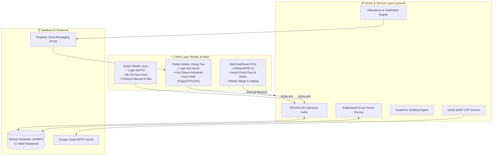

## Informasi Akademik 

* **Mata Kuliah:** Pemrograman Mobile
* **Dosen:** BAYU SULISTIYANTO IPUNG SUTEJO, S.Kom., M.Kom
* **Kelompok:** Kelompok 7 (Kelas KH002)
* **Mengembangankan Proyek:** Smart School: Sistem Absensi Wajah & Monitoring Siswa (SMP & SMA)
* **Institusi:** Universitas Esa Unggul / Fakultas Ilmu Komputer

## 👥 Team Pengembangan
* Muhammad Geraldi Arisyi : Sebagai Fullstack Mobile Developer
* Rafi Maulana Saputra : Sebagai Fullstack Mobile Developer
* Bintang Saputra : Sebagai Fullstack Mobile Developer
* Muhammad Naufal Al Ali : Sebagai Fullstack Mobile Developer


# 🎓 Smart School: Sistem Absensi Wajah & Monitoring Siswa (SMP & SMA)

[](https://flutter.dev)
[](https://dart.dev)
[](https://laravel.com)
[](https://php.net)
[](https://www.apachefriends.org)
[](https://developers.google.com/ml-kit)
[](https://www.figma.com/design/1FR3rY6gK4UyihXOJ1VENl/pemmob?node-id=0-1)

> **Slogan:** *"Sekolah pintar, masa depan hebat"*  
> **Tugas Praktikum Pemrograman Mobile / Proyek Kelompok 7 (Kelas KH002)**  
> **Pengembang:** Muhammad Geraldi Arisyi & Tim Kelompok 7

---

## 📖 1. Tentang Proyek

**Smart School** adalah platform sistem informasi sekolah terpadu yang mendigitalkan pencatatan kehadiran siswa menggunakan teknologi **Pengenalan Wajah (Face Recognition)** yang bekerja secara **instan (< 0.5 detik)** di kelas. 

Sistem ini menghubungkan **Tata Usaha (Admin Web)**, **Guru Pengajar**, dan **Orang Tua Murid** secara *real-time* untuk memastikan transparansi kehadiran serta perkembangan nilai akademik siswa (Tugas, UTS, dan UAS).

### 🎯 Masalah yang Diselesaikan:
1. **Menghilangkan Kecurangan Absensi:** Tidak ada lagi *titip absen*, kartu tertinggal, atau pemalsuan tanda tangan.
2. **Efisiensi Waktu Mengajar:** Pemindaian wajah cepat di depan kamera HP guru menghemat 10–15 menit waktu kelas dibanding absensi kertas manual.
3. **Transparansi Penuh untuk Orang Tua:** Orang tua langsung menerima notifikasi kehadiran anak di kelas dan dapat memantau rincian nilai tugas/ujian secara berkala dari rumah.
4. **Otomatisasi Administrasi TU:** Sekolah tidak perlu mengetik ratusan data siswa dari nol, melainkan cukup memanfaatkan fitur **Import Massal dari File Excel**.

---

## 🎨 2. Referensi Desain UI/UX (Figma)

Desain antarmuka mobile dirancang menggunakan Figma dengan pendekatan modern dan ramah pengguna:
* 🔗 **Link Desain Figma:** [Figma Design - pemmob](https://www.figma.com/design/1FR3rY6gK4UyihXOJ1VENl/pemmob?node-id=0-1)
* 📱 **Interactive Prototype:** [Buka ux_prototype.html](file:///C:/Users/hocky/.gemini/antigravity/brain/89ac97c0-7a74-4c0f-8956-fc86d4a43e73/ux_prototype.html)
* 📄 **Dokumen Spesifikasi Desain:** [UX_DESIGN_SPECIFICATION.md](file:///d:/PROJECT/-Muhammad_Geraldi_Arisyi_kelompok-7_kh002/UX_DESIGN_SPECIFICATION.md)

---

## 🌟 3. Fitur Utama Berdasarkan Peran

### 💻 A. Admin Sekolah / Tata Usaha (Web Dashboard)
* **Import Data Massal via Excel:** Upload 1 file Excel data guru dan siswa+wali murid (NIS, Nama Siswa, Kelas, Tanggal Lahir, Nama Wali, Gmail Wali) langsung terdaftar otomatis di database.
* **Registrasi Foto Wajah Master:** Mengunggah foto wajah referensi master siswa untuk model AI pengenalan wajah.
* **Manajemen Akun Guru & Orang Tua:** Mengelola profil, mengaktifkan/menonaktifkan akun, serta reset sandi darurat.
* **Manajemen Rombel & Jadwal:** Mengatur alokasi jadwal mata pelajaran mingguan (Senin–Jumat) per kelas.
* **Monitoring & Laporan:** Rekapitulasi absensi bulanan dan nilai kelas siap cetak.

### 📱 B. Guru Pengajar (Mobile App)
* **Login Khusus NUPTK:** Masuk menggunakan 16 digit NUPTK resmi dan kata sandi.
* **Absensi Wajah Instan (Live Face Scan):** Arahkan kamera ke siswa $\rightarrow$ sistem mengenali wajah $\rightarrow$ status **LANGSUNG HADIR** disertai bunyi *beep* dan centang hijau.
* **Fallback Presensi Manual:** Tombol koreksi darurat (Hadir, Sakit, Izin, Alpa) jika server/kamera sedang bermasalah.
* **Jadwal & Mata Pelajaran Aktif:** Melihat jadwal mengajar hari ini dan sesi kelas yang sedang berlangsung.
* **Pengelolaan Nilai Akademik:** Menginput dan memperbarui nilai **Tugas**, **UTS**, dan **UAS** per kelas.
* **Lupa Kata Sandi via Gmail OTP:** Menerima 6-digit kode OTP ke Gmail resmi untuk mereset kata sandi secara mandiri.

### 👨‍👩‍👧 C. Orang Tua Murid (Mobile App)
* **Login Praktis dengan NIS Murid:** Masuk menggunakan NIS anak dan kata sandi tanpa perlu registrasi rumit.
* **Live Dashboard Kehadiran:** Menampilkan status kehadiran anak hari ini (*"Sudah di Sekolah - Hadir pukul 07:35 WIB"*).
* **Riwayat Kehadiran per Mata Pelajaran:** Rincian status kehadiran anak di tiap slot jam pelajaran.
* **Kartu Nilai Akademik:** Melihat nilai Tugas, UTS, dan UAS anak secara transparan beserta catatan evaluasi dari guru.
* **Lupa Kata Sandi via Gmail OTP:** Mengirimkan kode OTP ke Gmail orang tua yang terdaftar di sekolah.

---

## 🏗️ 4. Arsitektur Sistem & Alur Data



---

## 📁 5. Struktur Direktori Proyek

Proyek ini menggunakan struktur modular terpisah agar pengerjaan bersih, terisolasi, dan mudah dibagi tugas dalam kelompok:

```text
D:\PROJECT\-Muhammad_Geraldi_Arisyi_kelompok-7_kh002\
│
├── backend/                       📁 [Backend REST API & Web Admin]
│   ├── app/
│   │   ├── Http/Controllers/Api/  -> Auth, Attendance, Grade, ForgotPassword Controller
│   │   ├── Models/                -> User, Teacher, Parent, Student, Schedule, Grade, dll.
│   │   └── Imports/               -> Skrip Import Excel Siswa & Guru
│   ├── database/
│   │   ├── migrations/            -> 11 File Migrasi Tabel MySQL
│   │   └── seeders/               -> Data Dummy Sampel Realistis
│   ├── routes/
│   │   └── api.php                -> Kontrak Jalur REST API
│   ├── composer.json
│   └── .env                       -> Konfigurasi Database & Gmail SMTP
│
├── mobile/                        📁 [Aplikasi Mobile Flutter - Smart School]
│   ├── lib/
│   │   ├── core/constants/        -> URL API & Theme Colors (Smart School Blue)
│   │   ├── core/services/         -> Face Detection (ML Kit) & Audio Feedback
│   │   ├── features/auth/         -> Layar Login NUPTK/NIS & Dialog OTP
│   │   ├── features/guru/         -> Layar Face Scan, Presensi Manual & Input Nilai
│   │   └── features/ortu/         -> Layar Dashboard Live Status & Kartu Nilai
│   ├── assets/
│   │   ├── images/                -> Logo Smart School & Ilustrasi
│   │   └── models/                -> Model AI Wajah MobileFaceNet (.tflite)
│   └── pubspec.yaml
│
├── docs/                          📁 [Dokumen Rekayasa Perangkat Lunak]
│   ├── PRD_SISTEM_ABSENSI_WAJAH.md
│   ├── ARSITEKTUR_SISTEM_ABSENSI_WAJAH.md
│   ├── UX_DESIGN_SPECIFICATION.md
│   └── IMPLEMENTATION_PLAN_FASE.md
│
└── README.md                      📄 Petunjuk & Dokumentasi Utama
```

---

## 🗺️ 6. Peta Jalan Pengerjaan (5 Fase)

| Fase | Fokus Pekerjaan | Target Luaran |
| :---: | :--- | :--- |
| **Fase 1** | **Backend, Database & Import Excel** | Database MySQL 11 tabel siap, Web Admin Filament aktif, upload Excel data sekolah berjalan. |
| **Fase 2** | **Otentikasi & Gmail OTP** | Login Guru (NUPTK), Login Ortu (NIS), dan pengiriman OTP 6 digit ke Gmail berfungsi. |
| **Fase 3** | **Core API Absensi & Nilai** | Endpoint presensi wajah langsung hadir, fallback manual, dan input nilai Tugas/UTS/UAS selesai. |
| **Fase 4** | **Mobile App Flutter (Figma UI)** | Layar login Smart School, kamera deteksi wajah ML Kit, dan dashboard orang tua selesai di HP. |
| **Fase 5** | **Integrasi & Persiapan Demo** | Pengujian antar-perangkat via Wi-Fi/Ngrok dan penyusunan naskah presentasi ke dosen. |

---

## 🚀 7. Panduan Menjalankan Sistem (Getting Started)

### Prasyarat Perangkat Lunak:
* **PHP:** Versi 8.2 atau 8.5 (sudah terpasang di sistem).
* **Composer:** Versi 2.8+ (sudah terpasang di sistem).
* **MySQL:** Melalui XAMPP (Port 3306).
* **Flutter SDK:** Versi 3.47+ (sudah terpasang di sistem).
* **Android Studio / VS Code** beserta ekstensi Flutter & Dart.

---

### Langkah 1: Menjalankan Backend (Laravel & MySQL)
1. Buka **XAMPP Control Panel**, lalu klik **Start** pada modul **MySQL**.
2. Buka terminal, masuk ke folder `backend`:
   ```bash
   cd backend
   ```
3. Salin file `.env` dan pasang dependensi:
   ```bash
   copy .env.example .env
   composer install
   php artisan key:generate
   ```
4. Jalankan migrasi dan seeder data contoh:
   ```bash
   php artisan migrate:fresh --seed
   ```
5. Jalankan server lokal:
   ```bash
   php artisan serve
   ```
   *Server backend akan aktif di: `http://127.0.0.1:8000`*  
   *Dashboard Web Admin dapat diakses di: `http://127.0.0.1:8000/admin`*

---

### Langkah 2: Menjalankan Aplikasi Mobile (Flutter)
1. Buka terminal kedua, masuk ke folder `mobile`:
   ```bash
   cd mobile
   ```
2. Ambil paket dependensi:
   ```bash
   flutter pub get
   ```
3. Sesuaikan alamat IP backend pada file `lib/core/constants/api_constants.dart`:
   ```dart
   // Jika menggunakan HP Fisik (Pastikan Laptop & HP dalam 1 jaringan Wi-Fi):
   static const String baseUrl = "http://192.168.1.XX:8000/api";

   // Jika menggunakan Emulator Android:
   static const String baseUrl = "http://10.0.2.2:8000/api";
   ```
4. Jalankan aplikasi ke perangkat HP atau emulator:
   ```bash
   flutter run
   ```

---

### 🌐 Bekerja Beda Rumah / Beda Internet? (Gunakan Ngrok - 100% Gratis)
Jika anggota tim mengerjakan dari rumah masing-masing:
1. Anggota yang memegang server Laravel cukup menjalankan:
   ```bash
   ngrok http 8000
   ```
2. Salin URL publik yang dihasilkan (misal: `https://xxxx.ngrok-free.app`), lalu berikan ke tim mobile.
3. Tim mobile cukup mengganti `baseUrl` di Flutter menjadi:
   ```dart
   static const String baseUrl = "https://xxxx.ngrok-free.app/api";
   ```
4. Aplikasi mobile langsung terhubung secara *real-time* lewat internet tanpa biaya hosting!

---

